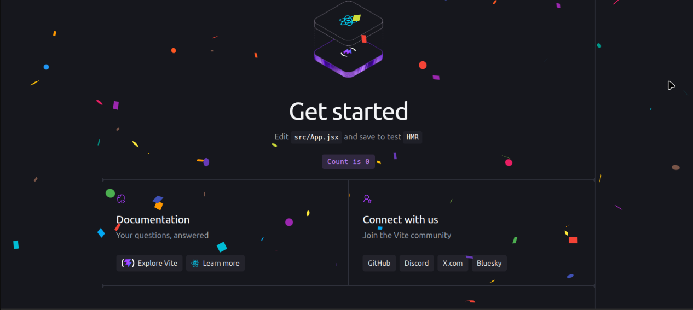
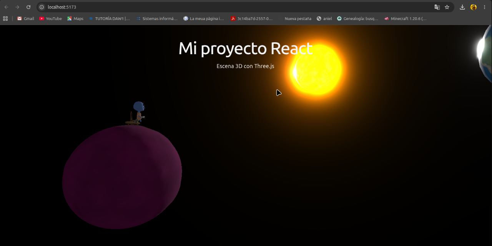

# Actividad Vite Project

## 1. Creación del proyecto

Hemos creado un proyecto utilizando Vite, seleccionando React como framework y JavaScript como lenguaje.

Para instalar las dependencias y arrancar el proyecto hemos utilizado:

```bash
npm install
npm run dev
```

Para generar la versión final de la página web:

```bash
npm run build
```

El resultado de la compilación se guarda en la carpeta `dist/`.

## 2. Trabajo con Git y ramas

Durante la actividad hemos creado las siguientes ramas:

- `main`: rama principal del proyecto.
- `react-confetti`: prueba de la librería React Confetti.
- `canvas-confetti`: prueba de Canvas Confetti.
- `three`: incorporación de la escena 3D.

Hemos realizado commits en cada rama y posteriormente hemos fusionado en `main` las funcionalidades elegidas.

## 3. React Confetti

En la rama `react-confetti` hemos instalado y probado la dependencia `react-confetti`.



## 4. Canvas Confetti

En la rama `canvas-confetti` hemos instalado la dependencia `canvas-confetti` y creado un botón que permite lanzar confeti al pulsarlo.


## 5. Escena 3D con Three.js

En la rama `three` hemos añadido el componente `PlanetScene.jsx`, utilizando Three.js para mostrar una escena 3D como fondo de la página.

También hemos colocado el archivo `EscenaMain-Rig.glb` dentro de la carpeta `public/`.



## 6. Fusiones y resultado final

Hemos elegido `canvas-confetti` como librería de confeti para la versión principal.

Después hemos fusionado la rama `canvas-confetti` con `main` y también hemos fusionado la rama `three`.

Durante la fusión de la escena 3D apareció un conflicto en `App.jsx`, que resolvimos manualmente.

Finalmente, hemos integrado la escena 3D y el botón de confeti en la página principal.

## 7. Pregunta sobre node_modules

**Si la carpeta `node_modules/` está excluida, ¿borrar una dependencia hace alguna acción sobre el repositorio? ¿Cuál?**

Sí. Aunque la carpeta `node_modules/` esté excluida del repositorio, al desinstalar una dependencia se modifican los archivos `package.json` y `package-lock.json`.

Git detecta esos cambios porque estos archivos no están excluidos. Por tanto, podemos añadirlos y guardarlos mediante un commit para registrar la eliminación de la dependencia.

## 8. Repositorio de GitHub

El proyecto y sus cuatro ramas están subidos a GitHub:

[Ver repositorio en GitHub](https://github.com/alexgcvlc007/actividad-viteproject)

## 9. Página web desplegada

La página web se ha publicado mediante GitHub Pages.

[Ver página web](https://alexgcvlc007.github.io/actividad-viteproject-web-3/)
